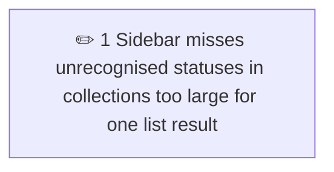

# Brindley sidebar initiatives

Planned work on the brindley-sidebar Claude Code plugin: the pane beside the chat that shows a repository's initiatives.

<!-- brindley:generated:begin — do not edit by hand; regenerate instead -->

### Active

| # | Initiative | Type | Status | Ready / blocked by | Open Qs | Owner |
|---|------------|------|--------|--------------------|---------|-------|
| 1 | [Sidebar misses unrecognised statuses in collections too large for one list result](01-sidebar-misses-unrecognised-statuses-in-collections-too-larg.md) | bug | draft | — | 1 | — |

### Dependencies

### Completed

_None._

<!-- brindley:generated:end -->
